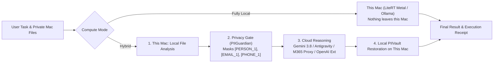

# MacHybridAI

**Run Computer tasks locally on your Mac—or pair cloud models with local work protected by an on-device Privacy Gate.**

`MacHybridAI` is an open-source macOS AI Hybrid Compute application inspired by [Perplexity Hybrid Compute](https://www.perplexity.ai/hub/products/hybrid-compute). It combines a native **SwiftUI macOS Desktop & Menu Bar App** with a **Python Hybrid Compute & Google Antigravity Engine** that runs tasks either **100% on-device** or in **Hybrid Mode** with automatic PII redaction and local restoration.

---

## Key Features

### 1. Two Ways to Run Computer: Fully Local or Hybrid
- **Fully Local Mode (`local`)**: Both the model and the agent directing the task run on your Mac (via `google-antigravity` `LiteRTAgentConfig` on Apple Silicon Metal GPU, `LocalOpenAIAgentConfig` with Ollama/LM Studio, or native on-device processing). **Nothing leaves your Mac.**
- **Hybrid Mode (`hybrid`)**:
  1. **This Mac**: Local agent processes private files on your Mac.
  2. **Privacy Gate (PII Guardian)**: Scans prompts and file context on-device, masking personal information (Names, Emails, Phone Numbers, SSNs, Luhn-validated Credit Cards, API Keys/Secrets, IPv4 addresses, and custom sensitive terms) with reversible stand-in tokens (`[PERSON_1]`, `[EMAIL_1]`, `[PHONE_1]`, etc.).
  3. **Cloud Models**: Cloud models perform research and reasoning using the stand-in tokens only.
  4. **Result**: Local and cloud work are combined on your Mac and stand-in tokens are automatically restored to their real values from the local in-memory `PIIVault`.

### 2. Multi-Provider Cloud & Local Architecture
- **Default Cloud Providers**:
  - **Google Gemini (`gemini-3.8-flash`)**: Powered by the `google-genai` (>= 2.3.0) Interactions API (`client.interactions.create`).
  - **Google Antigravity (`antigravity-preview-05-2026` & `google-antigravity` SDK)**: Supports `LocalAgentConfig`, `LiteRTAgentConfig`, `LocalOpenAIAgentConfig`, and Managed Remote Antigravity Agents.
- **Microsoft 365 Copilot Proxy Integration ([`cramt/m365-copilot-proxy`](https://github.com/cramt/m365-copilot-proxy))**:
  - Built-in lifecycle manager (`M365CopilotProxyManager`) for `m365-proxy` (`http://127.0.0.1:4141/v1`), supporting `M365_ENABLE_INTERACTIVE_APPROVAL=1`, `M365_AVOID_THROTTLING=1`, and temporary-chat mode (`disableMemory=1`).
  - Full **Prompt-Emulated Markdown-Fence & Shell-Routing Tool Calling** (`M365ToolEmulator`): Injects `<tools>` fenced templates, routes ```` ```bash ```` blocks directly to `run_command`/`bash`, and parses scalar `key: value` headers, body arguments, and aider-style `SEARCH/REPLACE` diffs into OpenAI `tool_calls`.
  - Defaults to `gpt-5.5-think-deeper` (recommended for tool calling) and supports `gpt-6.1-sol`, `gpt-6-sol`, `gpt-6-think-deeper`, `claude-sonnet-4.6`, and `claude-opus-4.8`.
- **OpenAI Extension Method (`openai_compatible`)**:
  - Easily configure any OpenAI-compatible `/v1/chat/completions` endpoint (OpenAI, OpenRouter, Groq, vLLM, Together, Azure).

---

## Architecture Diagram



---

## Quick Start on macOS

### 1. Run Unit & Security Tests
```bash
# Run Python Hybrid Engine & Privacy Gate tests
PYTHONPATH=backend python3 -m unittest discover -s backend/tests -v

# Build and test the native SwiftUI macOS application
swift build
swift test -v
```

### 2. Package and Launch `MacHybridAI.app`
```bash
chmod +x bundle.sh package.sh
./bundle.sh
open MacHybridAI.app
```

### 3. Build Distributable `.pkg` and `.dmg` Installers
```bash
./package.sh
ls -lh dist/
```

---

## GitHub Workflow & PR Governance
All code committed to this repository follows a strict Pull Request workflow targeting `main` and is verified by native GitHub Actions:
- **CI & Unit Testing (`.github/workflows/ci.yml`)**: Runs Python matrix unit tests (`3.11`, `3.12` on `ubuntu-latest` and `macos-14`) and macOS Swift 6 build, `swift test`, `.app` bundling, and `.pkg`/`.dmg` verification.
- **Security Scanning (`.github/workflows/security.yml`)**: Runs GitHub **CodeQL SAST** (`python` & `swift`), **GitHub Dependency Review**, **Bandit SAST**, and the **Privacy Gate Zero-PII-Leak Regression Suite**.

## License
MIT License — see [LICENSE](LICENSE).
