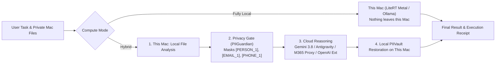

# MacHybridAI

**Run Computer tasks locally on your Mac—or pair cloud models with local work protected by an on-device Privacy Gate.**

`MacHybridAI` is an open-source macOS AI Hybrid Compute application inspired by [Perplexity Hybrid Compute](https://www.perplexity.ai/hub/products/hybrid-compute). It combines a native **SwiftUI macOS Desktop & Menu Bar App** with a **Python Hybrid Compute & Google Antigravity Engine** that runs tasks either **100% on-device** or in **Hybrid Mode** with automatic PII redaction and local restoration.

---

## Native macOS Installation Package (`.dmg` & `.pkg`)

Always-up-to-date native Apple Silicon (`arm64` Metal / MLX) & macOS 14+ installers are built and published automatically on [GitHub Releases](https://github.com/mzia/MacHybridAI/releases):

| Package Format | Download Link | Description |
| :--- | :--- | :--- |
| **macOS Disk Image (`.dmg`)** | [**`MacHybridAI-latest.dmg`**](https://github.com/mzia/MacHybridAI/releases/latest/download/MacHybridAI-latest.dmg) | Drag-and-drop `MacHybridAI.app` into `/Applications` |
| **macOS Package Installer (`.pkg`)** | [**`MacHybridAI-latest.pkg`**](https://github.com/mzia/MacHybridAI/releases/latest/download/MacHybridAI-latest.pkg) | Standard macOS Installer package targeting `/Applications/MacHybridAI.app` |
| **Zipped App Archive (`.app.zip`)** | [**`MacHybridAI-latest-macos-arm64.app.zip`**](https://github.com/mzia/MacHybridAI/releases/latest/download/MacHybridAI-latest-macos-arm64.app.zip) | Self-contained app bundle with embedded Python Hybrid Engine |
| **SHA-256 Checksums** | [**`SHA256SUMS.txt`**](https://github.com/mzia/MacHybridAI/releases/latest/download/SHA256SUMS.txt) | Cryptographic SHA-256 digests for all release artifacts |

---

## Documentation, Manual (`man`) & Wiki

Full setup and usage documentation is available in the [**MacHybridAI Wiki**](wiki/Home.md) and the UNIX manual page ([`man/MacHybridAI.1`](man/MacHybridAI.1) — view via `man ./man/MacHybridAI.1`):

| Main Wiki Section | Topics Covered |
| :--- | :--- |
| [**1. MacHybridAI User Manual & Architecture (`wiki/Home.md`)**](wiki/Home.md) | 4-Station Split-Compute pipeline, Desktop Studio, `M⇄AI` Menu Bar HUD, Compute Modes (`Fully Local`, `Hybrid`, `Auto`), and `MacHybridAI(1)` `man` reference |
| [**2. Installation & Setup Guide (`wiki/Installation-and-Setup.md`)**](wiki/Installation-and-Setup.md) | Native `.dmg` / `.pkg` installation, building from source (`./bundle.sh` / `./package.sh`), and environment configuration |
| [**3. Apple Silicon Hardware Profiler & Local Models (`wiki/Apple-Silicon-Hardware-Profiler-and-Local-Models.md`)**](wiki/Apple-Silicon-Hardware-Profiler-and-Local-Models.md) | Metal GPU working-set sizing, 1-Click Metal Benchmark (`TTFT`, `Prefill/Decode tok/s`), HuggingFace shard verification, and Thermal/RAM guardrails |
| [**4. Privacy Gate & Zero-Cloud History (`wiki/Privacy-Gate-and-Zero-Cloud-History.md`)**](wiki/Privacy-Gate-and-Zero-Cloud-History.md) | On-device PII masking (`[PERSON_1]`, `[EMAIL_1]`, etc.), local `PIIVault` restoration, encrypted Local/iCloud history, and Execution Receipts |
| [**5. Optional Cloud Provider: M365 Copilot Proxy (`wiki/M365-Copilot-Proxy-Setup-and-Usage.md`)**](wiki/M365-Copilot-Proxy-Setup-and-Usage.md) | Optional integration with [`cramt/m365-copilot-proxy`](https://github.com/mzia/MacHybridAI/blob/main/wiki/M365-Copilot-Proxy-Setup-and-Usage.md) (`m365-proxy`), Entra MFA sign-in, and `<tools>` markdown-fence tool calling |

---

## Key Features

### 1. Apple Silicon Hardware Profiler, Metal Benchmark & Thermal/RAM Guardrail
- **Hardware-Aware Model Sizing (`HardwareProfiler`)**: Automatically detects Apple Silicon SoC topology (Performance + Efficiency CPU cores, GPU cores via `IOAccelerator` `ioreg`, Unified Memory, and Metal `max_recommended_working_set_size`).
- **Local Cache Shard Validator**: Verifies HuggingFace cache completeness (`model.safetensors` / `model.safetensors.index.json` shards) before calling `mlx_lm.load()` so uncached multi-GB models never hang inference.
- **1-Click Apple Silicon Benchmark (`/v1/hardware/benchmark`)**: Measures live **Time-to-First-Token (TTFT ms)**, **Prefill tok/s**, **Decode tok/s**, and **Peak Metal Memory (GB)** directly from the SwiftUI Hardware Optimizer panel or Menu Bar popover.
- **Thermal & Unified Memory Pressure Guardrail**: Monitors thermal state (`nominal`, `fair`, `serious`, `critical`) and unified memory pressure, automatically stepping down to a compact 4-bit model (`mlx-community/gemma-3-4b-it-4bit`) if memory usage exceeds 85% or thermal pressure spikes.
- **Native `MenuBarExtra` Quick-Prompt HUD**: Always-accessible macOS menu bar item (`M⇄AI`) with live GPU/RAM/Thermal badges, PII mask counter, 1-click Metal benchmark, and instant Local/Hybrid chat.

### 2. Two Ways to Run Computer: Fully Local or Hybrid
- **Fully Local Mode (`local`)**: Both the model and the agent directing the task run on your Mac (via `google-antigravity` `LiteRTAgentConfig` on Apple Silicon Metal GPU, `LocalOpenAIAgentConfig` with Ollama/LM Studio, or native on-device processing). **Nothing leaves your Mac.**
- **Hybrid Mode (`hybrid`)**:
  1. **This Mac**: Local agent processes private files on your Mac.
  2. **Privacy Gate (PII Guardian)**: Scans prompts and file context on-device, masking personal information (Names, Emails, Phone Numbers, SSNs, Luhn-validated Credit Cards, API Keys/Secrets, IPv4 addresses, and custom sensitive terms) with reversible stand-in tokens (`[PERSON_1]`, `[EMAIL_1]`, `[PHONE_1]`, etc.).
  3. **Cloud Models**: Cloud models perform research and reasoning using the stand-in tokens only.
  4. **Result**: Local and cloud work are combined on your Mac and stand-in tokens are automatically restored to their real values from the local in-memory `PIIVault`.

### 2. Multi-Provider Cloud & Local Architecture
- **Default Cloud Providers**:
  - **Google Gemini (`gemini-3.8-flash`)**: Powered by the `google-genai` (>= 2.3.0) Interactions API (`client.interactions.create`).
  - **Google Antigravity (`antigravity-preview-05-2026` & `google-antigravity` SDK)**: Supports `LocalAgentConfig`, `LiteRTAgentConfig`, `LocalOpenAIAgentConfig`, and Managed Remote Antigravity Agents.
- **Microsoft 365 Copilot Proxy Integration ([`cramt/m365-copilot-proxy`](https://github.com/cramt/m365-copilot-proxy))**:
  - Built-in lifecycle manager (`M365CopilotProxyManager`) for `m365-proxy` (`http://127.0.0.1:4141/v1`), supporting `M365_ENABLE_INTERACTIVE_APPROVAL=1`, `M365_AVOID_THROTTLING=1`, and temporary-chat mode (`disableMemory=1`).
  - Full **Prompt-Emulated Markdown-Fence & Shell-Routing Tool Calling** (`M365ToolEmulator`): Injects `<tools>` fenced templates, routes ```` ```bash ```` blocks directly to `run_command`/`bash`, and parses scalar `key: value` headers, body arguments, and aider-style `SEARCH/REPLACE` diffs into OpenAI `tool_calls`.
  - Defaults to `gpt-5.5-think-deeper` (recommended for tool calling) and supports `gpt-6.1-sol`, `gpt-6-sol`, `gpt-6-think-deeper`, `claude-sonnet-4.6`, and `claude-opus-4.8`.
- **OpenAI Extension Method (`openai_compatible`)**:
  - Easily configure any OpenAI-compatible `/v1/chat/completions` endpoint (OpenAI, OpenRouter, Groq, vLLM, Together, Azure).

---

## Architecture Diagram



---

## Quick Start on macOS

### 1. Run Unit & Security Tests
```bash
# Run Python Hybrid Engine & Privacy Gate tests
PYTHONPATH=backend python3 -m unittest discover -s backend/tests -v

# Build and test the native SwiftUI macOS application
swift build
swift test -v
```

### 2. Package and Launch `MacHybridAI.app`
```bash
chmod +x bundle.sh package.sh
./bundle.sh
open MacHybridAI.app
```

### 3. Build Distributable `.pkg` and `.dmg` Installers
```bash
./package.sh
ls -lh dist/
```

---

## GitHub Workflow & PR Governance
All code committed to this repository follows a strict Pull Request workflow targeting `main` and is verified by native GitHub Actions:
- **CI & Unit Testing (`.github/workflows/ci.yml`)**: Runs Python matrix unit tests (`3.11`, `3.12` on `ubuntu-latest` and `macos-14`) and macOS Swift 6 build, `swift test`, `.app` bundling, and `.pkg`/`.dmg` verification.
- **Security Scanning (`.github/workflows/security.yml`)**: Runs GitHub **CodeQL SAST** (`python` & `swift`), **GitHub Dependency Review**, **Bandit SAST**, and the **Privacy Gate Zero-PII-Leak Regression Suite**.

## License
MIT License — see [LICENSE](LICENSE).
