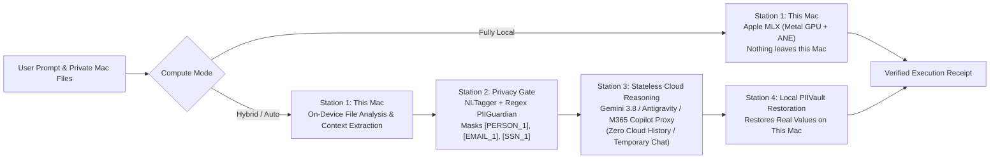

# MacHybridAI Wiki

Welcome to the official **MacHybridAI** Wiki!

**MacHybridAI** is a native macOS Apple Silicon (`arm64` Metal / MLX) & Hybrid Compute AI Studio that runs tasks either **100% locally on your Mac** or in **Hybrid Split-Compute Mode**—pairing local private file analysis and an on-device **PII Guardian Privacy Gate** with stateless cloud reasoning (**Google Gemini 3.8**, **Google Antigravity**, **[`cramt/m365-copilot-proxy`](https://github.com/cramt/m365-copilot-proxy)**, or **OpenAI-Compatible** endpoints).

---

## Quick Navigation

1. **[Installation & Setup](Installation-and-Setup)**
   - 1-Click Native macOS `.dmg` & `.pkg` Installers, building from source, and setting up Apple Silicon MLX.
2. **[M365 Copilot Proxy Setup & Usage (`cramt/m365-copilot-proxy`)](M365-Copilot-Proxy-Setup-and-Usage)**
   - Complete guide to installing, authenticating, selecting SignalR tones (`gpt-5.5-think-deeper`, `gpt-6.1-sol`, `claude-sonnet-4.6`), temporary-chat zero-retention mode, and Markdown-fence tool calling.
3. **[Apple Silicon Hardware Profiler, Metal Benchmark & Local Models](Apple-Silicon-Hardware-Profiler-and-Local-Models)**
   - Hardware-matched model sizing (`4B` to `70B`), local HuggingFace shard verification, 1-click Metal benchmarking (`TTFT`, `Prefill/Decode tok/s`), and automatic Thermal/RAM pressure guardrails.
4. **[Privacy Gate (PII Guardian) & Zero Cloud History](Privacy-Gate-and-Zero-Cloud-History)**
   - How reversible PII masking (`[PERSON_1]`, `[EMAIL_1]`, `[SSN_1]`), local `PIIVault` restoration, and encrypted Local Mac / iCloud Drive prompt history work.

---

## 1-Click Native macOS Installers

Always-up-to-date native Apple Silicon (`arm64`) installers are published on [GitHub Releases](https://github.com/mzia/MacHybridAI/releases):

- **Drag-and-Drop Disk Image (`.dmg`)**: [`MacHybridAI-latest.dmg`](https://github.com/mzia/MacHybridAI/releases/latest/download/MacHybridAI-latest.dmg)
- **macOS Package Installer (`.pkg`)**: [`MacHybridAI-latest.pkg`](https://github.com/mzia/MacHybridAI/releases/latest/download/MacHybridAI-latest.pkg)
- **Zipped App Bundle (`.app.zip`)**: [`MacHybridAI-latest-macos-arm64.app.zip`](https://github.com/mzia/MacHybridAI/releases/latest/download/MacHybridAI-latest-macos-arm64.app.zip)
- **SHA-256 Checksums**: [`SHA256SUMS.txt`](https://github.com/mzia/MacHybridAI/releases/latest/download/SHA256SUMS.txt)

---

## Split-Compute Architecture Overview

