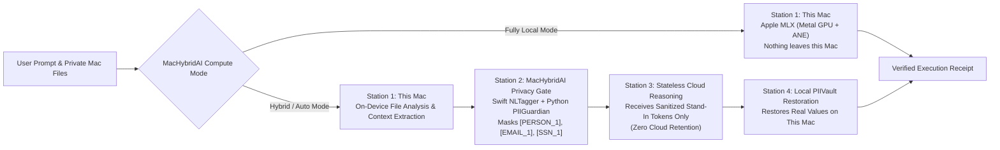

# MacHybridAI Wiki & User Manual

Welcome to the official **MacHybridAI** documentation.

**MacHybridAI** is a native macOS Apple Silicon (`arm64` Metal / MLX) and Hybrid Split-Compute AI application. It lets you run AI tasks **100% locally on your Mac** (so nothing ever leaves your device) or in **Hybrid Split-Compute Mode**—combining local private file analysis and an on-device **PII Guardian Privacy Gate** with stateless cloud reasoning and automatic local restoration.

---

## Table of Contents (Main Sections)

1. **[How MacHybridAI Works (4-Station Split-Compute Architecture)](#1-how-machybridai-works-4-station-split-compute-architecture)**
2. **[Installing & Launching MacHybridAI on macOS](#2-installing--launching-machybridai-on-macos)**
3. **[Using MacHybridAI: Desktop Studio & `M⇄AI` Menu Bar HUD](#3-using-machybridai-desktop-studio--mai-menu-bar-hud)**
4. **[MacHybridAI Compute Modes (`Fully Local`, `Hybrid`, `Auto`)](#4-machybridai-compute-modes-fully-local-hybrid-auto)**
5. **[MacHybridAI Apple Silicon Hardware Profiler & Metal Benchmark](#5-machybridai-apple-silicon-hardware-profiler--metal-benchmark)**
6. **[MacHybridAI Privacy Gate (`PIIGuardian`) & Zero Cloud History](#6-machybridai-privacy-gate-piiguardian--zero-cloud-history)**
7. **[`MacHybridAI(1)` Manual (`man`) Reference (CLI, Daemon & REST API)](#7-machybridai1-manual-man-reference-cli-daemon--rest-api)**
8. **[Detailed Sub-Guides](#8-detailed-sub-guides)**

---

## 1. How MacHybridAI Works (4-Station Split-Compute Architecture)

`MacHybridAI` executes every task through an auditable 4-station pipeline modeled on on-device + cloud split compute:



- **Station 1 — This Mac (Local Compute & File Processing)**: Reads attached local files on your Mac and executes local Apple Silicon MLX inference (`mlx_lm` on Metal GPU). In **Fully Local Mode**, the task finishes here and nothing ever touches the network.
- **Station 2 — On-Device Privacy Gate (`PIIGuardian`)**: Scans prompts and local file summaries on your Mac using macOS `NaturalLanguage` (`NLTagger`) plus regex/Luhn checksum scanners. Sensitive values (names, emails, phones, SSNs, credit cards, API keys, IPv4 addresses, custom terms) are replaced with numbered stand-in tokens (`[PERSON_1]`, `[EMAIL_1]`, `[PHONE_1]`) stored only in your Mac's in-memory `PIIVault`.
- **Station 3 — Stateless Cloud Reasoning**: Sends *only* the sanitized prompt containing stand-in tokens to your selected cloud provider with zero-retention flags (`store=False`, `X-No-Store: true`).
- **Station 4 — Local `PIIVault` Restoration & Execution Receipt**: Combines local and cloud work on your Mac, restores `[PERSON_1]` back to its real value from `PIIVault`, and attaches a cryptographic **Execution Receipt** to the message.

---

## 2. Installing & Launching MacHybridAI on macOS

### Native macOS Installers (`.dmg` & `.pkg`)

Download the latest native Apple Silicon (`arm64`) installer from [GitHub Releases](https://github.com/mzia/MacHybridAI/releases/latest):

| Package Format | Download Link | Installation Method |
| :--- | :--- | :--- |
| **macOS Disk Image (`.dmg`)** | [**`MacHybridAI-latest.dmg`**](https://github.com/mzia/MacHybridAI/releases/latest/download/MacHybridAI-latest.dmg) | Open `.dmg` and drag **`MacHybridAI.app`** into `/Applications` |
| **macOS Package Installer (`.pkg`)** | [**`MacHybridAI-latest.pkg`**](https://github.com/mzia/MacHybridAI/releases/latest/download/MacHybridAI-latest.pkg) | Double-click to install into `/Applications/MacHybridAI.app` |
| **Zipped App Bundle (`.app.zip`)** | [**`MacHybridAI-latest-macos-arm64.app.zip`**](https://github.com/mzia/MacHybridAI/releases/latest/download/MacHybridAI-latest-macos-arm64.app.zip) | Unzip and move `MacHybridAI.app` to `/Applications` |
| **SHA-256 Checksums** | [**`SHA256SUMS.txt`**](https://github.com/mzia/MacHybridAI/releases/latest/download/SHA256SUMS.txt) | Verify via `shasum -a 256 -c SHA256SUMS.txt` |

```bash
# Clear quarantine attribute on first launch (for ad-hoc signed open-source builds) and open:
xattr -cr /Applications/MacHybridAI.app
open /Applications/MacHybridAI.app
```

---

## 3. Using MacHybridAI: Desktop Studio & `M⇄AI` Menu Bar HUD

When `MacHybridAI.app` is running, it provides two native macOS interfaces backed by the embedded Python Hybrid Engine on `http://127.0.0.1:8765`:

### A. The Main `MacHybridAI` Desktop Studio Window
The sidebar organizes `MacHybridAI` into four workspaces:
1. **Hybrid Compute Chat**:
   - Stream responses with live 4-Station progress indicators (**Station 1: This Mac** -> **Station 2: Privacy Gate** -> **Station 3: Cloud** -> **Station 4: Restored**).
   - Attach private local files (`Attach Local File`) so Station 1 summarizes or extracts context on-device before any cloud step.
   - Expand the **Execution Receipt** beneath any assistant reply to inspect local vs. cloud model usage, `Prefill/Decode tok/s`, peak Metal memory, and exact PII token counts.
2. **History & iCloud Sync**:
   - Search and reload past prompts stored either on **Local Mac (`~/.machybrid/history/`)** or **iCloud Drive (`~/Library/Mobile Documents/com~apple~CloudDocs/MacHybridAI/`)**.
   - Configure automatic retention expiration (`24h`, `7d`, `30d`, `90d`, or `Never Delete`) while guaranteeing **Zero Cloud AI History**.
3. **Privacy Gate (PII) Inspector**:
   - Live interactive sandbox where you can paste sensitive text, add custom confidential project/client terms, and preview the **Sanitized Cloud Payload** alongside the **Restored Local Output**.
4. **AI Providers & Hardware Optimizer**:
   - Inspect your Apple Silicon SoC, Metal GPU working-set budget, and recommended MLX models.
   - Run the **1-Click Metal Benchmark**, download/verify HuggingFace `.safetensors` shards in-app, and configure cloud providers.

### B. The `M⇄AI` macOS Menu Bar Quick-Prompt HUD
Click the persistent **`M⇄AI`** icon in the top-right macOS menu bar from any application to:
- View live **GPU %**, **RAM %**, **Thermal State**, and **Active Guardrail** status badges.
- Switch between **Fully Local**, **Hybrid**, and **Auto** compute modes on the fly.
- Send a quick prompt with real-time on-device PII detection badges (`N PII masked` or `No PII detected`).
- Trigger a **1-Click Metal Benchmark** (`Decode tok/s` & `TTFT ms`) or open the main studio window.

---

## 4. MacHybridAI Compute Modes (`Fully Local`, `Hybrid`, `Auto`)

| Compute Mode | How MacHybridAI Routes Your Task | Network / Cloud Activity |
| :--- | :--- | :--- |
| **`Fully Local` (`local`)** | Runs 100% on your Mac's Apple Silicon Metal GPU / Neural Engine via `MLXProvider` (`mlx_lm`) or local Ollama/LiteRT. | **Zero network calls.** Nothing leaves your Mac. |
| **`Hybrid` (`hybrid`)** | Analyses local files on your Mac (Station 1), masks PII into `[TYPE_N]` stand-in tokens (Station 2), runs cloud reasoning on sanitized tokens (Station 3), and restores real values locally (Station 4). | Only sanitized text with `[TYPE_N]` stand-in tokens is sent to the cloud with `store=False`. |
| **`Auto` (`auto`)** | Automatically selects `Fully Local` for sensitive/offline tasks or when `force_local_on_pii` triggers, and `Hybrid` for research/multi-step reasoning tasks. | Enforces the active Privacy Gate policy automatically. |

---

## 5. MacHybridAI Apple Silicon Hardware Profiler & Metal Benchmark

`MacHybridAI` includes `HardwareProfiler` ([`backend/machybrid/profiler.py`](../backend/machybrid/profiler.py)), which inspects your Mac's hardware without root privileges:
- **Metal Working-Set Calculation**: Queries `sysctl`, `IOAccelerator` (`ioreg`), and `mlx.core.device_info()` to compute safe GPU memory limits (`max_recommended_working_set_size`).
- **Shard-Verified Local Model Selection**: Validates every `.safetensors` shard in `~/.cache/huggingface/hub` before loading so incomplete downloads never freeze the app.
- **1-Click Metal Benchmark (`/v1/hardware/benchmark`)**: Measures real **Time-to-First-Token (`TTFT ms`)**, **Prefill `tok/s`**, **Decode `tok/s`**, and **Peak Metal Memory (`GB`)**.
- **Thermal & Unified Memory Guardrail**: Automatically steps down from large models (`>= 12B`) to a compact 4-bit model (`mlx-community/gemma-3-4b-it-4bit`) if unified memory exceeds `85%` or macOS thermal state enters `serious`/`critical`.

---

## 6. MacHybridAI Privacy Gate (`PIIGuardian`) & Zero Cloud History

- **Detected Entity Categories**: `PERSON`, `ORG`, `PLACE` (via macOS `NaturalLanguage` `NLTagger`), plus `EMAIL`, `PHONE`, `SSN`, `CREDIT_CARD` (Luhn-validated), `SECRET` (API keys/tokens), `IPV4`, and `CUSTOM_TERM`.
- **Three Selectable Privacy Policies**:
  - `reversible_mask` *(Default)*: Masks PII with `[PERSON_1]`, `[EMAIL_1]` before cloud calls and restores real values locally from `PIIVault`.
  - `strict_redact`: Permanently redacts PII (`[REDACTED_EMAIL]`) without restoration.
  - `force_local_on_pii`: Automatically diverts any prompt containing PII to **Fully Local Mode** on your Mac.

---

## 7. `MacHybridAI(1)` Manual (`man`) Reference (CLI, Daemon & REST API)

### `NAME`
**`MacHybridAI`** / **`machybrid.server`** — macOS Apple Silicon Local & Hybrid Split-Compute AI Studio and Loopback Engine

### `SYNOPSIS`
```bash
# Launch the native macOS Desktop Studio & Menu Bar app
open /Applications/MacHybridAI.app

# Run the Python Hybrid Compute loopback daemon directly
PYTHONPATH=backend python3 -m machybrid.server [--host 127.0.0.1] [--port 8765]

# Build & package MacHybridAI from source
./bundle.sh
./package.sh
```

### `DESCRIPTION`
**`MacHybridAI`** combines a native Swift 6 / SwiftUI macOS application (`Sources/MacHybridAI/`) with a loopback-only Python Hybrid Compute engine (`backend/machybrid/`). For security, `machybrid.server` strictly refuses to bind to non-loopback interfaces (`127.0.0.1` / `localhost` only).

### `ENVIRONMENT`
| Variable | Default | Description |
| :--- | :--- | :--- |
| `MAC_HYBRID_PORT` | `8765` | Loopback TCP port for the local `machybrid.server` HTTP daemon |
| `MAC_HYBRID_LOCAL_PROVIDER` | `mlx` | On-device inference backend (`mlx`, `litert`, `ollama`, `mock`) |
| `MAC_HYBRID_LOCAL_MODEL` | Auto-selected by `HardwareProfiler` | HuggingFace MLX repo ID (e.g., `mlx-community/gemma-3-4b-it-4bit`) |
| `MAC_HYBRID_CLOUD_PROVIDER` | `gemini` | Active cloud provider (`gemini`, `antigravity`, `m365_copilot`, `openai_compatible`) |
| `MAC_HYBRID_CLOUD_MODEL` | `gemini-3.8-flash` | Cloud model ID used in Station 3 (`Hybrid` mode) |
| `GEMINI_API_KEY` | — | Google Gemini API key (used with `store=False`) |
| `ANTIGRAVITY_API_KEY` | — | Google Antigravity SDK API key |
| `OPENAI_API_KEY` | — | API key for OpenAI-compatible endpoints |

### `LOCAL LOOPBACK REST API (127.0.0.1:8765)`
| Method & Endpoint | Description |
| :--- | :--- |
| `GET /v1/health` | Health status, active providers, live CPU/GPU/RAM telemetry, and guardrail state |
| `POST /v1/task` | Execute a synchronous `local`, `hybrid`, or `auto` task and return result + Execution Receipt |
| `POST /v1/task/stream` | Execute a Server-Sent Events (SSE) streaming task with real-time station updates |
| `POST /v1/privacy/inspect` | Scan text with `PIIGuardian` and return sanitized text, token map, and PII counts |
| `GET /v1/hardware/profile` | Full Apple Silicon SoC profile, Metal working-set budget, and cached model catalog |
| `POST /v1/hardware/benchmark` | Run on-device Metal MLX benchmark (`ttft_ms`, `prefill_tps`, `decode_tps`, `peak_memory_gb`) |
| `POST /v1/hardware/models/pull` | Verify or download HuggingFace MLX model shards (`revision="main"`) |
| `GET /v1/history` / `POST /v1/history/settings` | List, filter, delete, or migrate Local Mac / iCloud Drive prompt history |

### `FILES`
- `/Applications/MacHybridAI.app` — Self-contained macOS application bundle (SwiftUI binary + embedded `.venv` + Python engine)
- `~/.machybrid/history/` — Encrypted local prompt history storage
- `~/Library/Mobile Documents/com~apple~CloudDocs/MacHybridAI/` — Optional iCloud Drive prompt history storage
- `~/.cache/huggingface/hub/` — Local HuggingFace `.safetensors` model cache inspected by `HardwareProfiler`

---

## 8. Detailed Sub-Guides

- **[Installation & Setup](Installation-and-Setup)** — `.dmg` / `.pkg` installation, building from source, and environment setup.
- **[Apple Silicon Hardware Profiler, Metal Benchmark & Local Models](Apple-Silicon-Hardware-Profiler-and-Local-Models)** — Model sizing (`3B`–`31B`), shard verification, 1-click benchmarking, and Thermal/RAM guardrails.
- **[Privacy Gate (PII Guardian) & Zero Cloud History](Privacy-Gate-and-Zero-Cloud-History)** — On-device PII masking, `PIIVault` restoration, and Local Mac / iCloud Drive retention policies.
- **[Optional Provider Guide: M365 Copilot Proxy (`cramt/m365-copilot-proxy`)](M365-Copilot-Proxy-Setup-and-Usage)** — Connecting `MacHybridAI` to an enterprise Microsoft 365 Copilot subscription via `m365-proxy`.
