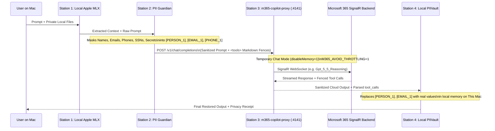

# M365 Copilot Proxy Setup and Usage (`cramt/m365-copilot-proxy`)

`MacHybridAI` includes first-class, native integration with **[`cramt/m365-copilot-proxy`](https://github.com/cramt/m365-copilot-proxy)**, allowing you to use your organization's Microsoft 365 Copilot subscription as a **Stateless Hybrid Cloud Reasoning Station** protected by `MacHybridAI`'s on-device **PII Guardian Privacy Gate**.

---

## 1. Architecture: How `MacHybridAI` + `m365-copilot-proxy` Work Together



---

## 2. Installing `cramt/m365-copilot-proxy`

`MacHybridAI`'s [`M365CopilotProxyManager`](https://github.com/mzia/MacHybridAI/blob/main/backend/machybrid/m365_proxy.py) automatically discovers `m365-copilot-proxy` in any of the following locations:

### Method A: Clone into `~/.local/share/m365-copilot-proxy` (Recommended)
```bash
mkdir -p ~/.local/share
git clone https://github.com/cramt/m365-copilot-proxy.git ~/.local/share/m365-copilot-proxy
cd ~/.local/share/m365-copilot-proxy
pnpm install
```

### Method B: Global Binary on `PATH`
If you link `m365-proxy` onto your `PATH` (or have `npx m365-proxy` available), `MacHybridAI` will invoke `m365-proxy <port>` directly.

---

## 3. Authentication & Security Settings

### Interactive Browser SSO / MFA Approval (Default)
By default, `MacHybridAI` launches `m365-proxy` with:
- `M365_ENABLE_INTERACTIVE_APPROVAL=1`: Allows interactive Entra ID browser login and MFA approval when tokens expire.
- `M365_AVOID_THROTTLING=1`: Activates the `PerUserThrottled` reserve guard so long multi-turn agent sessions aren't rate-limited.
- **Zero Cloud History (`disableMemory=1`)**: `MacHybridAI` **never** sets `M365_SAVE_HISTORY` (and strips it if present in the shell environment), ensuring all M365 Copilot sessions run in ephemeral **Temporary Chat** mode.

### Pre-Configured Secrets File (Optional)
If you already use `opencode-m365`, `MacHybridAI` automatically detects:
```text
~/.config/opencode-m365/secrets.json
```
and displays `Secrets Configured: Yes` in the `MacHybridAI` M365 status panel.

---

## 4. Supported M365 Models & SignalR Tones

`MacHybridAI` includes the full `M365ModelCatalog` and automatically upgrades unsafe magic model strings (`m365-copilot` or `auto`) to **`gpt-5.5-think-deeper`**:

| Model ID in `MacHybridAI` | Underlying M365 SignalR Tone | Tool Calling Recommended | Seat Requirement | Description |
| :--- | :--- | :---: | :---: | :--- |
| **`gpt-5.5-think-deeper`** *(Default)* | `Gpt_5_5_Reasoning` | Yes | Standard | Best overall default for agents & tool calling (100% tool harness compliance) |
| **`gpt-6.1-sol`** | `Gpt_61_Sol_Reasoning` | Yes | Standard | Works on every Entra ID work/school account (40/40 on bench with `relay_batch`) |
| **`gpt-6-sol`** | `Gpt_6_Sol_Reasoning` | Yes | Standard | High-reliability reasoning tone across all accounts |
| **`gpt-6-think-deeper`** | `Gpt_6_Reasoning` | Yes | Premium Copilot Seat | Deep GPT-6 reasoning with `relay_batch` framing |
| **`gpt-5.6-think-deeper`** | `Gpt_5_6_Reasoning` | Yes | Standard | Fast GPT-5.6 reasoning tone |
| **`claude-sonnet-4.6`** | `Claude_Sonnet` | Yes | Standard | Anthropic Claude Sonnet 4.6 via M365 Copilot |
| **`claude-opus-4.8`** | `Claude_Opus` | Yes | Premium Copilot Seat | Anthropic Claude Opus 4.8 via M365 Copilot |
| **`gpt-5.5`** | `Gpt_5_5_Chat` | No | Standard | Fast non-reasoning chat tone |

---

## 5. Using M365 Copilot Proxy in the `MacHybridAI` App

### Step 1: Select M365 Copilot Proxy as Cloud Provider
1. Open **`MacHybridAI.app`**.
2. In the top toolbar, set:
   - **Compute Mode**: `Hybrid` (or `Auto Hybrid`)
   - **Cloud Provider**: `M365 Copilot Proxy`
3. Open the **AI Providers & M365** tab (tab `4`) to customize:
   - **Proxy Loopback Port**: `4141` (default `http://127.0.0.1:4141/v1`)
   - **M365 Tone / Model**: `gpt-5.5-think-deeper` (or `gpt-6.1-sol`, `claude-sonnet-4.6`, etc.)
   - **Interactive Browser SSO/MFA Approval**: Enabled (`ON`)
   - **Avoid PerUserThrottled Reserve Guard**: Enabled (`ON`)

### Step 2: Send a Hybrid Prompt with Automatic PII Protection
Type any prompt containing sensitive client or project details in the composer:
> *"Rework the Meridian valuation for Sam Reyes (sam.reyes@meridian.io, 415-555-2671) and compare against Q3 SaaS multiples."*

1. **Station 1 (This Mac)**: Local Apple Silicon MLX model analyzes any attached local files on-device.
2. **Station 2 (Privacy Gate)**: Masks `Sam Reyes` -> `[PERSON_1]`, `sam.reyes@meridian.io` -> `[EMAIL_1]`, `415-555-2671` -> `[PHONE_1]`.
3. **Station 3 (M365 Copilot Proxy)**: Sends **only** the masked prompt to `http://127.0.0.1:4141/v1/chat/completions` in Temporary Chat mode (`disableMemory=1`).
4. **Station 4 (Result)**: Restores `Sam Reyes`, `sam.reyes@meridian.io`, and `415-555-2671` locally on your Mac and attaches a cryptographic **Execution Receipt**.

---

## 6. Prompt-Emulated Tool Calling (`M365ToolEmulator`)

Because M365 SignalR does not natively expose raw OpenAI function-calling schemas, `MacHybridAI` implements `cramt/m365-copilot-proxy`'s **Markdown-Fence & Shell-Routing Tool Calling Protocol** in `M365ToolEmulator`:

1. **Tool Prompt Injection**: Converts OpenAI `tools` into a `<tools>` Markdown-fenced instruction block.
2. **Automatic Shell Routing**: When a shell tool (`run_command`, `bash`, `sh`, `zsh`) is declared, ` ```bash ` code blocks emitted by M365 Copilot are automatically routed into structured `tool_calls`.
3. **`SEARCH/REPLACE` Diff Parsing**: Parses aider-style `<<<<<<< SEARCH ... ======= ... >>>>>>> REPLACE` blocks into `old` and `new` arguments for file-editing tools.

### API Example: Controlling & Testing M365 Proxy via Loopback REST API
```bash
# Check M365 Proxy status & available models
curl -s http://127.0.0.1:8765/v1/m365/status | python3 -m json.tool

# Start the managed m365-proxy process
curl -s -X POST http://127.0.0.1:8765/v1/m365/control \
  -H "Content-Type: application/json" \
  -d '{"action": "start"}' | python3 -m json.tool
```
